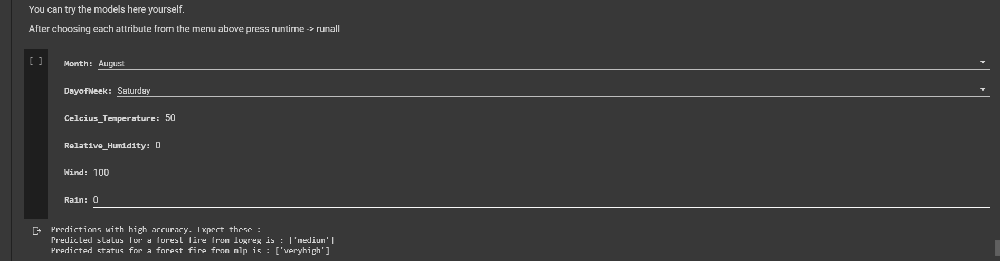
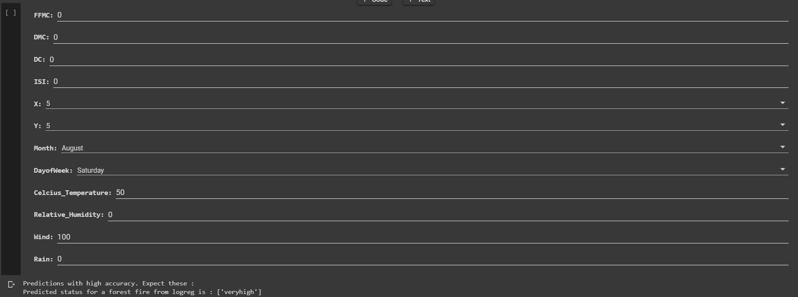

# Forestfires-Prediction-with-Machine-Learning

Machine learning experiments on the UCI forest fires dataset (Cortez and Morais, 2007) in a single Jupyter notebook. It first predicts the burned area as a regression problem, then turns it into a 5-class classification problem (very low to very high) using K-Means cluster centroids and fuzzy membership labels.

## How to run

The whole project is one notebook, `Forestfires_prediction_with_Machine_Learning.ipynb`, written for Google Colab. The dataset is downloaded from the UCI archive at runtime, so no local data files are needed.

Open the notebook in Google Colab (badge link at the top of the notebook) and run all cells. Interactive prediction forms are built with Colab form fields, so they only render in Colab.

To run locally instead:

```
pip install pandas numpy scikit-learn matplotlib seaborn jupyter
jupyter notebook Forestfires_prediction_with_Machine_Learning.ipynb
```

When running locally, skip the `google.colab` Drive mount cell and the `#@param` form cells, which are Colab-only.

Models used:

- Regression: ordinary least squares, Ridge, Lasso, KNN regressor
- Classification: KNN, SVM (linear and polynomial kernels), logistic regression, MLP, Gaussian process classifier

## Screenshots

Prediction form for the classifier with month, day of week, temperature, humidity, wind and rain:



Prediction form for the classifier with X and Y grid coordinates and FWI values added:



## Tech used

- Python
- scikit-learn
- pandas, NumPy
- Matplotlib, Seaborn
- Jupyter / Google Colab

## Status

Coursework, 2020.

## License

MIT License. See [LICENSE](LICENSE).
