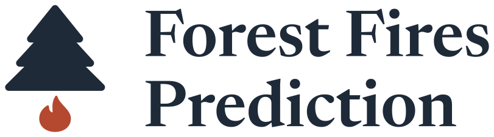
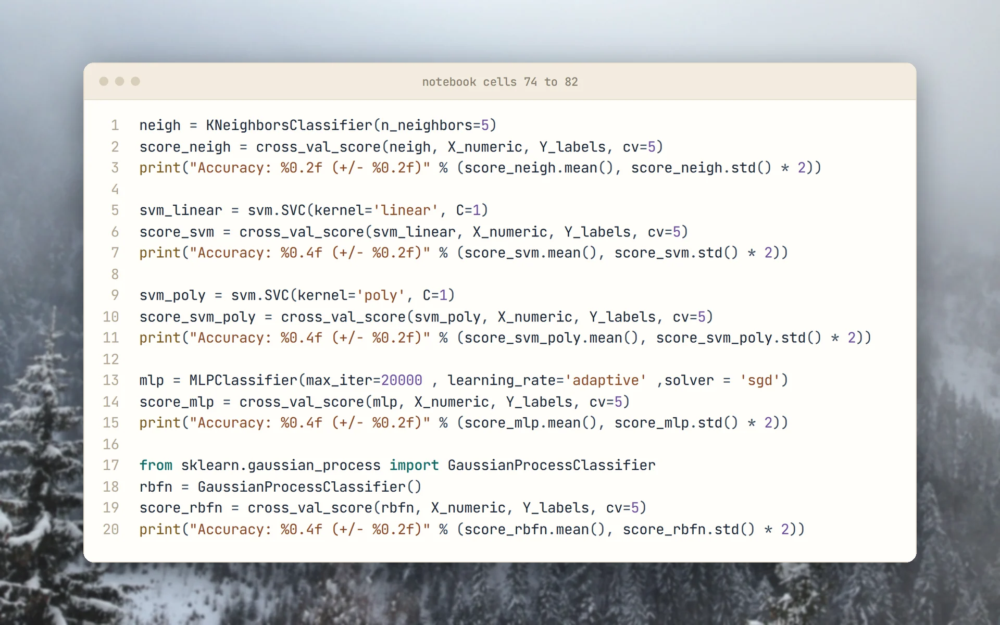
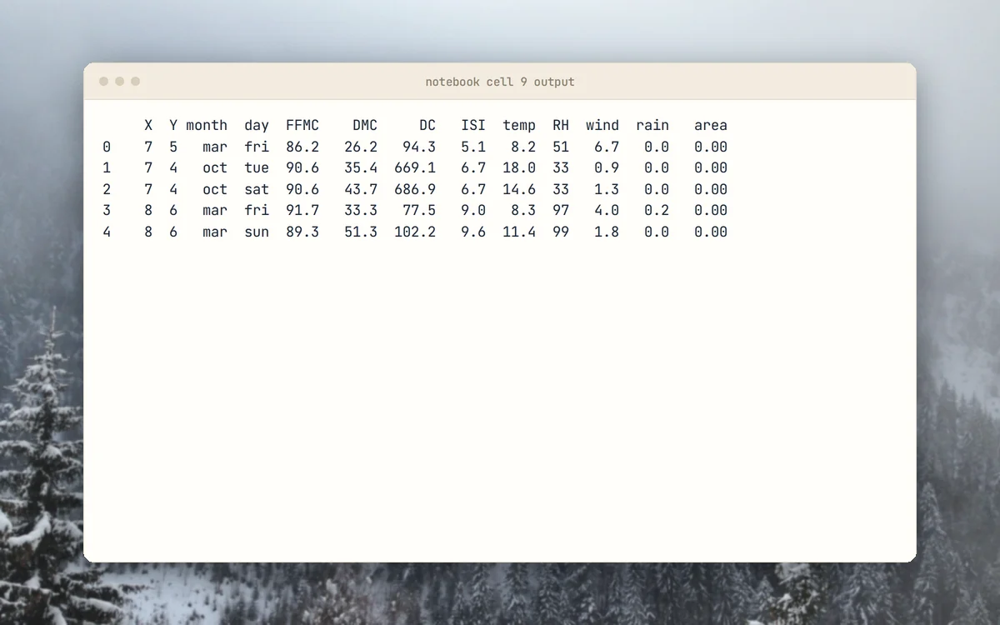
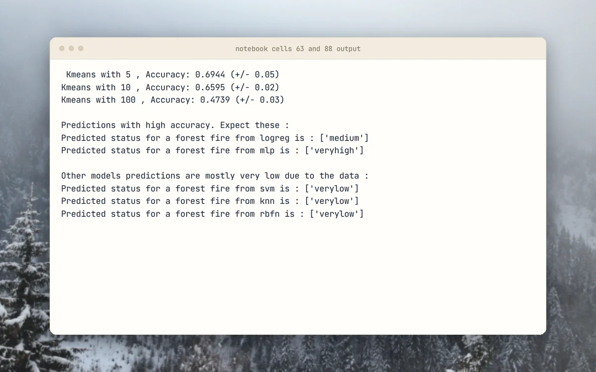
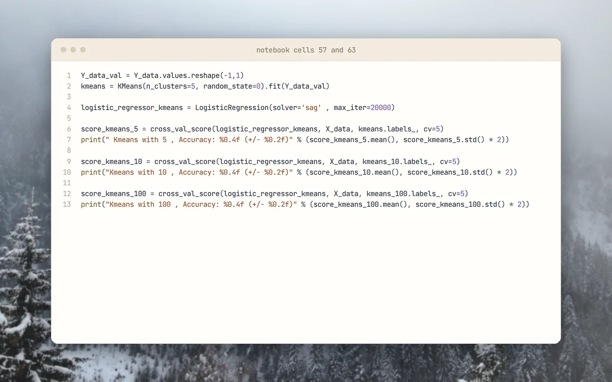
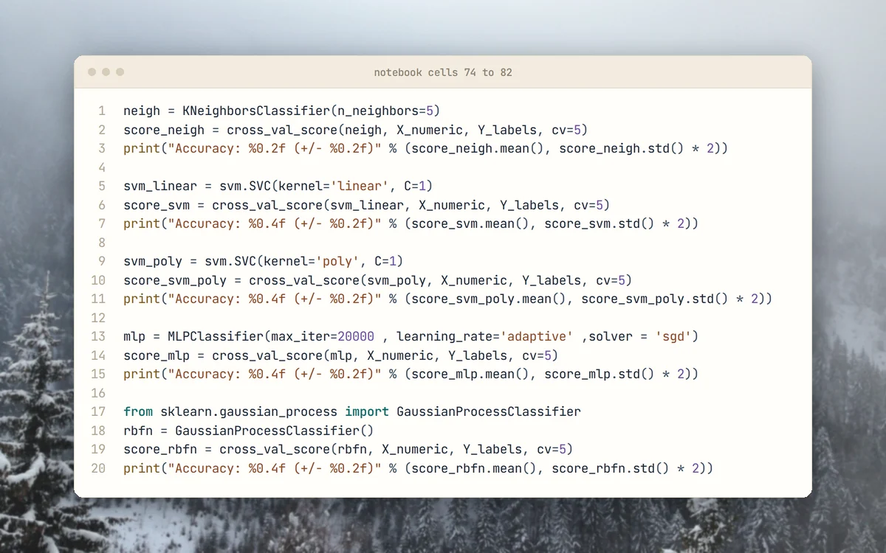

<p align="center">
  <picture>
    <source media="(prefers-color-scheme: dark)" srcset="docs/brand/svg/forest-fires-logo-on-dark.svg">
    
  </picture>
</p>

<h1 align="center">One notebook. From fire weather to burned area.</h1>

<p align="center">
  Coursework from 2020: machine learning on the UCI Forest Fires dataset.<br>
  <b>Regression first, then five burn-size classes.</b>
</p>

<p align="center">
  <a href="LICENSE"></a>
  
  
  
  
  <a href="https://github.com/mertkayacs/Forestfires-Prediction-with-Machine-Learning"></a>
</p>

<p align="center">
  <a href="https://colab.research.google.com/github/mertkayacs/Forestfires-Prediction-with-Machine-Learning/blob/master/Forestfires_prediction_with_Machine_Learning.ipynb"></a>
  <a href="Forestfire%20Prediction%20Paper%20by%20Mert%20KAYA.pdf"></a>
  <a href="#quick-start"></a>
</p>

<p align="center">
  <picture>
    <source media="(prefers-color-scheme: dark)" srcset="docs/assets/readme/hero-dark.webp">
    
  </picture>
</p>

Forest Fires Prediction is a single Jupyter notebook that studies the UCI Forest Fires dataset (Cortez and Morais, 2007). It first predicts the burned area as a regression problem, then turns the area into five classes from very low to very high and compares several classifiers. The notebook was written for Google Colab and includes forms where you enter weather values and read the predicted class. A short paper in Turkish describes the results.

---

## Why Forest Fires Prediction

The notebook walks through the problem from both directions.

|  |  |
|---|---|
|  **Regression, then classes** | Ordinary least squares, Ridge, Lasso and a KNN regressor predict the area. Most rows have an area of zero or close to it, so the notebook then groups the target into five classes. |
|  **Classes from K-Means** | K-Means centroids and fuzzy membership values produce the five labels. KNN, SVM with linear and polynomial kernels, logistic regression, an MLP and a Gaussian process classifier are compared. |
|  **Forms you can try** | Colab form fields take month, day, temperature, humidity, wind and rain, and optionally grid coordinates and FWI values, and print the predicted class. |
|  **A paper in Turkish** | The repository includes a paper that reports a best 5-fold cross-validation accuracy of 61.32 percent, from an SVM on month, weekday, temperature, humidity and wind. |

## A quick tour

<table>
  <tr>
    <td width="50%" valign="top">
      <picture>
        <source media="(prefers-color-scheme: dark)" srcset="docs/assets/readme/tour/data-dark.webp">
        
      </picture>
      <h3>Dataset sample</h3>
      The first five rows of the UCI data as the notebook printed them, with grid coordinates, month, fire weather indices, weather and burned area.
    </td>
    <td width="50%" valign="top">
      <picture>
        <source media="(prefers-color-scheme: dark)" srcset="docs/assets/readme/tour/results-dark.webp">
        
      </picture>
      <h3>Saved results</h3>
      The notebook keeps its printed K-Means accuracies for 5, 10 and 100 clusters and the class each model predicted for an example input.
    </td>
  </tr>
  <tr>
    <td width="50%" valign="top">
      <picture>
        <source media="(prefers-color-scheme: dark)" srcset="docs/assets/readme/tour/kmeans-dark.webp">
        
      </picture>
      <h3>K-Means labels</h3>
      K-Means with five clusters labels the area, and logistic regression is scored for 5, 10 and 100 clusters.
    </td>
    <td width="50%" valign="top">
      <picture>
        <source media="(prefers-color-scheme: dark)" srcset="docs/assets/readme/tour/models-dark.webp">
        
      </picture>
      <h3>Classifier comparison</h3>
      KNN, two SVMs, an MLP and a Gaussian process classifier are cross-validated on the same labels.
    </td>
  </tr>
</table>

<p align="center"><sub>The terminal cards show the outputs saved in the notebook, and the code cards show its cells as they are in the repository. Nothing was re-run.</sub></p>

## Features

**Regression**

- Ordinary least squares, Ridge, Lasso and KNN, scored by MSE.
- Residual plot to check linearity.

**Classification**

- Five classes from K-Means centroids with fuzzy labels.
- Three feature sets: weather and calendar, plus grid coordinates, plus FWI indices.

## Quick start

Open the notebook in Google Colab with the button above and run all cells. The dataset downloads from the UCI archive at run time, so no data files are needed. To run it locally:

```sh
pip install pandas numpy scikit-learn matplotlib seaborn jupyter
jupyter notebook Forestfires_prediction_with_Machine_Learning.ipynb
```

Skip the google.colab Drive mount cell and the #@param form cells when running locally. The forms render only in Colab.

### Requirements

- Python 3 with the packages above, or a Google Colab session.

## FAQ

<details>
<summary><b>Where does the data come from?</b></summary>

The UCI Forest Fires dataset (Cortez and Morais, 2007), downloaded when the notebook runs.
</details>

<details>
<summary><b>Why classes instead of the exact area?</b></summary>

Most rows have an area at or near zero, which keeps the regression error high. The notebook groups the area into five classes with K-Means and fuzzy labels.
</details>

<details>
<summary><b>Do I need Colab?</b></summary>

The prediction forms need Colab. The analysis cells run locally.
</details>

<details>
<summary><b>Is there a write-up?</b></summary>

Yes. The paper in Turkish is in the repository as a PDF.
</details>

If Forest Fires Prediction is useful to you, a ⭐ helps other people find it.

## License

[MIT License](LICENSE). Photos behind the screenshots are credited in [docs/assets/readme/CREDITS.md](docs/assets/readme/CREDITS.md).

[](https://github.com/mertkayacs/Forestfires-Prediction-with-Machine-Learning)
